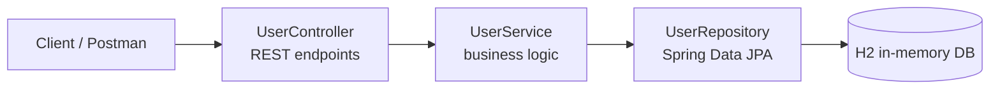

# MrHope Banking App

A Spring Boot REST API for basic banking operations: open an account, look up a balance or account name, and credit an account. It runs on an in-memory H2 database, so there is nothing to install or configure besides Java.


## Architecture



| Layer | Responsibility |
|---|---|
| `controller` | Receives HTTP requests and returns JSON responses |
| `service` | Account rules: duplicate check, account number generation, credit, debit, transfer |
| `repository` | Database access through Spring Data JPA |
| `entity` / `dto` | `User` table model and request/response objects |
| `exception` | Business errors and the global handler that turns them into HTTP responses |
| `utils` | Response codes, messages and account number generator |

## Tech stack

Java 17, Spring Boot 3.4, Spring Web, Spring Data JPA, Bean Validation, H2, Lombok, springdoc OpenAPI (Swagger UI), JUnit 5, Mockito, Maven, GitHub Actions, Docker.

## Run it

**With Maven**

```bash
./mvnw spring-boot:run
```

**With Docker**

```bash
docker build -t mrhope-banking-app .
docker run -p 8080:8080 mrhope-banking-app
```

The API is then available at `http://localhost:8080`. Data lives in memory and is cleared on restart. You can inspect it at `http://localhost:8080/h2-console` (JDBC URL `jdbc:h2:mem:bankdb`, user `sa`, empty password).

## Endpoints

Interactive docs (Swagger UI): `http://localhost:8080/swagger-ui.html`

Base path: `/api/user`

| Method | Path | Body | Success | Description |
|---|---|---|---|---|
| POST | `/api/user` | `UserRequest` | 201 | Create an account with a zero balance |
| GET | `/api/user/{accountNumber}/balance` | none | 200 | Account name and balance |
| GET | `/api/user/{accountNumber}/name` | none | 200 | Account holder's full name |
| POST | `/api/user/credit` | `{"accountNumber": "...", "amount": 50.00}` | 200 | Add money |
| POST | `/api/user/debit` | `{"accountNumber": "...", "amount": 20.00}` | 200 | Take money (refused if the balance is too low) |
| POST | `/api/user/transfer` | `{"sourceAccountNumber": "...", "destinationAccountNumber": "...", "amount": 10.00}` | 200 | Move money between two accounts atomically |

Rules: account numbers are 10 digits, amounts must be at least 0.01 with at most 2 decimal places, and the phone number must be 9 to 15 digits.

### Example

```bash
curl -X POST http://localhost:8080/api/user \
  -H "Content-Type: application/json" \
  -d '{"firstName":"Thabo","lastName":"Mokoena","email":"thabo@example.com","phoneNumber":"0710000000"}'
```

```json
{
  "responseCode": "002",
  "responseMessage": "Account has been successfully created",
  "accountInfo": {
    "accountName": "Thabo Mokoena",
    "accountBalance": 0,
    "accountNumber": "2026123456"
  }
}
```

### Errors

Every failure returns a proper HTTP status and the same JSON shape. Validation failures list each bad field:

```json
{
  "status": 400,
  "responseCode": "010",
  "responseMessage": "Request validation failed",
  "errors": { "email": "Email must be a valid address" }
}
```

| HTTP | Code | Meaning |
|---|---|---|
| 400 | 009 | Transfer to the same account |
| 400 | 010 | Validation failed, or the body is missing or not valid JSON |
| 404 | 003 | Account not found |
| 409 | 001 | An account already exists for that email |
| 422 | 007 | Insufficient funds |

Success codes: `002` account created, `004` account found, `005` credited, `006` debited, `008` transfer completed.

### Design notes

- Credit, debit and transfer run inside a database transaction and lock the account rows they change, so two requests at the same moment cannot overwrite each other's balance. A test fires 50 concurrent credits at one account and checks none are lost.
- A transfer is all or nothing: if anything fails, neither balance changes. Rows are always locked in the same order, so two opposite transfers cannot deadlock.
- Email and account number are unique in the database as well as checked in code, so a race between two sign-ups is still rejected.

## Tests

```bash
./mvnw test
```

Unit tests cover the service layer (Mockito) and the account number generator, the controller and its error responses are tested with `MockMvc`, and an integration test runs the full flow (create, credit, debit, transfer, concurrent credits) against H2. GitHub Actions runs the build and tests on every push and pull request.

## Roadmap

- Authentication with JWT, so each customer can only touch their own account
- Transaction history per account
- PostgreSQL profile for production use
