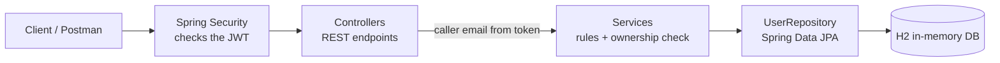

# MrHope Banking App

A Spring Boot REST API for basic banking: sign up, log in, check a balance, credit, debit and transfer. It is secured with JWT, and every customer can only touch their own account. It runs on an in-memory H2 database, so there is nothing to install besides Java.


## Architecture



| Layer | Responsibility |
|---|---|
| `config` | Security rules (which URLs are public), JWT signing key, JSON 401/403 responses, Swagger setup |
| `security` | `TokenService`: creates signed tokens |
| `controller` | Receives HTTP requests, passes the caller's identity to the service |
| `service` | Business rules: duplicate check, ownership check, credit, debit, transfer, login |
| `repository` | Database access through Spring Data JPA |
| `entity` / `dto` | `User` table model and request/response objects |
| `exception` | Business errors and the global handler that turns them into HTTP responses |
| `utils` | Response codes, messages and account number generator |

## Tech stack

Java 17, Spring Boot 3.4, Spring Web, Spring Security (OAuth2 resource server, JWT), Spring Data JPA, Bean Validation, H2, Lombok, springdoc OpenAPI (Swagger UI), JUnit 5, Mockito, Maven, GitHub Actions, Docker.

## Run it

**With Maven**

```bash
export JWT_SECRET=$(openssl rand -hex 32)
./mvnw spring-boot:run
```

**With Docker**

```bash
docker build -t mrhope-banking-app .
docker run -p 8080:8080 -e JWT_SECRET=$(openssl rand -hex 32) mrhope-banking-app
```

The API is then available at `http://localhost:8080`. Data lives in memory and is cleared on restart.

`JWT_SECRET` is the key that signs the tokens. It must be at least 32 characters and is never stored in the code. If you leave it out, the app generates a random key at startup, which is fine for trying it out, but every token stops working when the app restarts.

## Authentication and account ownership

Only **sign-up**, **login** and the **API docs** are public. Every other request needs `Authorization: Bearer <token>`.

```bash
# 1. Sign up (creates the customer and their account)
curl -X POST http://localhost:8080/api/auth/register \
  -H "Content-Type: application/json" \
  -d '{"firstName":"Thabo","lastName":"Mokoena","email":"thabo@example.com","phoneNumber":"0710000000","password":"Password123!"}'

# 2. Log in: the response contains the token and your account number
curl -X POST http://localhost:8080/api/auth/login \
  -H "Content-Type: application/json" \
  -d '{"email":"thabo@example.com","password":"Password123!"}'

# 3. Use the token
curl http://localhost:8080/api/user/2026123456/balance \
  -H "Authorization: Bearer <token>"
```

**How ownership works.** The token proves who is calling. The controller hands the caller's email to the service layer, and the service checks that the account belongs to that caller before it reads or changes anything. The rule lives in the service, not in the controller or the UI, so it also protects any future code that calls the service.

| Action | Rule |
|---|---|
| Balance, name, credit, debit | The account must be yours, otherwise `403` |
| Transfer | The **source** must be yours, otherwise `403`. The destination can be any account. |
| Unknown account | `404` |

Notes:
- A transfer from someone else's account returns `403` even if the destination does not exist, so strangers cannot use the response to probe which account numbers exist.
- Passwords are hashed with BCrypt and never returned or logged. Wrong password and unknown email give the identical `401`, so the login response does not reveal which emails have accounts.
- Tokens are signed with HS256, last 60 minutes (`app.jwt.expiry-minutes`), and are rejected if expired, tampered with, or signed with a different key.
- There are no sessions or cookies, so CSRF protection is not needed. The H2 console is switched off because it would expose the database without a login.

## Endpoints

Interactive docs (Swagger UI, with an **Authorize** button for your token): `http://localhost:8080/swagger-ui.html`

| Method | Path | Auth | Body | Success | Description |
|---|---|---|---|---|---|
| POST | `/api/auth/register` | public | `UserRequest` (includes `password`) | 201 | Sign up and create an account with a zero balance |
| POST | `/api/auth/login` | public | `{"email": "...", "password": "..."}` | 200 | Returns a JWT and your account number |
| GET | `/api/user/{accountNumber}/balance` | token | none | 200 | Account name and balance |
| GET | `/api/user/{accountNumber}/name` | token | none | 200 | Account holder's full name |
| POST | `/api/user/credit` | token | `{"accountNumber": "...", "amount": 50.00}` | 200 | Add money |
| POST | `/api/user/debit` | token | `{"accountNumber": "...", "amount": 20.00}` | 200 | Take money (refused if the balance is too low) |
| POST | `/api/user/transfer` | token | `{"sourceAccountNumber": "...", "destinationAccountNumber": "...", "amount": 10.00}` | 200 | Move money atomically |

Rules: passwords are 8 to 72 characters, account numbers are 10 digits, amounts must be at least 0.01 with at most 2 decimal places, and the phone number must be 9 to 15 digits.

Login response:

```json
{
  "token": "eyJhbGciOiJIUzI1NiJ9...",
  "tokenType": "Bearer",
  "expiresInSeconds": 3600,
  "accountNumber": "2026123456"
}
```

### Errors

Every failure returns a proper HTTP status and the same JSON shape. Validation failures list each bad field:

```json
{
  "status": 400,
  "responseCode": "010",
  "responseMessage": "Request validation failed",
  "errors": { "email": "Email must be a valid address" }
}
```

| HTTP | Code | Meaning |
|---|---|---|
| 400 | 009 | Transfer to the same account |
| 400 | 010 | Validation failed, or the body is missing or not valid JSON |
| 401 | 011 | Wrong email or password |
| 401 | 013 | No token, or the token is invalid or expired |
| 403 | 012 | The account belongs to someone else |
| 404 | 003 | Account not found |
| 409 | 001 | An account already exists for that email |
| 422 | 007 | Insufficient funds |

Success codes: `002` account created, `004` account found, `005` credited, `006` debited, `008` transfer completed.

### Design notes

- Credit, debit and transfer run inside a database transaction and lock the account rows they change, so two requests at the same moment cannot overwrite each other's balance. A test fires 50 concurrent credits at one account and checks none are lost.
- A transfer is all or nothing: if anything fails, neither balance changes. Rows are always locked in the same order, so two opposite transfers cannot deadlock.
- Email and account number are unique in the database as well as checked in code, so a race between two sign-ups is still rejected.

## Tests

```bash
./mvnw test
```

- **Service tests (Mockito):** every business rule, including that each operation refuses an account the caller does not own and leaves balances untouched.
- **Controller tests (`MockMvc`):** validation, error responses, and that every protected endpoint returns 401 without a token.
- **JWT tests:** a token verifies and carries the right subject and expiry; a token signed with another key, or with a forged payload, is rejected.
- **Integration tests:** the whole app against H2. Sign up, log in, credit, debit and transfer; expired, forged and garbage tokens; one customer trying to read, debit, credit or transfer out of another customer's account; passwords stored as BCrypt hashes; 50 concurrent credits.

GitHub Actions runs the build and tests on every push to `main` and every pull request.

## Roadmap

- Transaction history per account
- Rate limiting and account lockout after repeated failed logins
- Refresh tokens and logout (token revocation)
- PostgreSQL profile for production use
