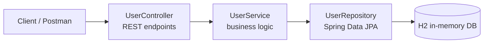

# MrHope Banking App

A Spring Boot REST API for basic banking operations: open an account, look up a balance or account name, and credit an account. It runs on an in-memory H2 database, so there is nothing to install or configure besides Java.


## Architecture



| Layer | Responsibility |
|---|---|
| `controller` | Receives HTTP requests and returns JSON responses |
| `service` | Account rules: duplicate check, account number generation, crediting |
| `repository` | Database access through Spring Data JPA |
| `entity` / `dto` | `User` table model and request/response objects |
| `utils` | Response codes, messages and account number generator |

## Tech stack

Java 17, Spring Boot 3.4, Spring Web, Spring Data JPA, H2, Lombok, JUnit 5, Mockito, Maven, GitHub Actions, Docker.

## Run it

**With Maven**

```bash
./mvnw spring-boot:run
```

**With Docker**

```bash
docker build -t mrhope-banking-app .
docker run -p 8080:8080 mrhope-banking-app
```

The API is then available at `http://localhost:8080`. Data lives in memory and is cleared on restart. You can inspect it at `http://localhost:8080/h2-console` (JDBC URL `jdbc:h2:mem:bankdb`, user `sa`, empty password).

## Endpoints

Base path: `/api/user`

| Method | Path | Body | Description |
|---|---|---|---|
| POST | `/api/user` | `UserRequest` | Create an account (rejected if the email already has one) |
| GET | `/api/user/balanceEnquiry` | `{"accountNumber": "..."}` | Get account name and balance |
| GET | `/api/user/nameEnquiry` | `{"accountNumber": "..."}` | Get the account holder's name |
| POST | `/api/user/credit` | `{"accountNumber": "...", "amount": 50.00}` | Add money to an account |

### Example

```bash
curl -X POST http://localhost:8080/api/user \
  -H "Content-Type: application/json" \
  -d '{"firstName":"Thabo","lastName":"Mokoena","gender":"Male","address":"1 Main Road","stateOfOrigin":"Gauteng","email":"thabo@example.com","phoneNumber":"0710000000"}'
```

```json
{
  "responseCode": "002",
  "responseMessage": "Account has been successfully created",
  "accountInfo": {
    "accountName": "Thabo Mokoena null",
    "accountBalance": 0,
    "accountNumber": "2026123456"
  }
}
```

### Response codes

| Code | Meaning |
|---|---|
| 001 | Account already exists |
| 002 | Account created |
| 003 | Account not found |
| 004 | Account found |
| 005 | Account credited |

## Tests

```bash
./mvnw test
```

Unit tests cover the service layer (Mockito) and the account number generator, and the controller is tested with `MockMvc`. GitHub Actions runs the build and tests on every push and pull request.

## Roadmap

- Debit and transfer endpoints
- Input validation and consistent error responses (HTTP status codes instead of response codes only)
- Authentication with JWT
- OpenAPI/Swagger documentation
